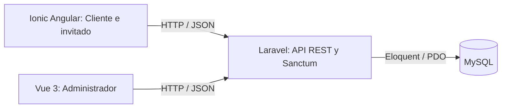

# Arquitectura

SwiftSite Clean mantiene tres aplicaciones en un único repositorio. Los nombres de sus carpetas son parte de los comandos de instalación y no se cambiaron.

## Backend

`Api-Rest/routes/api.php` define las rutas `/api`. Los controladores están en `app/Http/Controllers/Api`, los modelos en `app/Models` y el esquema en `database/migrations`. `Usuario` adapta la autenticación a `usuarios`, `id_usuario`, `correo` y `password_hash`; `User` es un remanente del scaffold y no es el proveedor activo.

Sanctum emite tokens Bearer de siete días. El registro crea Cliente. El login puede indicar un portal y rechaza un rol incompatible. El middleware `auth:sanctum` protege la sesión y el gate `administrar-catalogos` protege las escrituras administrativas. El cliente no decide importes ni roles.

`CotizacionController` valida zona, tarifas y cantidades; consulta precios activos y calcula importes usando centavos enteros. No crea pedidos. Ver [API.md](../Api-Rest/API.md) para contratos y códigos HTTP.

## Back Office

`swiftsite-admin/src/services/api.ts` centraliza Axios y la URL pública `VITE_API_URL`. `stores/auth.ts` mantiene sesión en Pinia/sessionStorage; `router/index.ts` consulta `/me` y protege las rutas. Las vistas de Dashboard, Pedidos y Clientes preparan la navegación; las gestiones completas pendientes están identificadas.

## Aplicación cliente

`swiftsite-ionic-angular/src/app/core` contiene autenticación, sesión, catálogos, guard e interceptor. La URL se define en `src/environments/environment.ts`. Las pestañas Inicio y Cotizar admiten invitados; Perfil y Pedidos exigen un Cliente autenticado. El outlet interno de las pestañas lo gestiona Ionic; no se agrega un outlet duplicado encima del contenido.

El diseño de Inicio, fotos, comparador y privacidad se conservan. Los servicios y credenciales se obtienen de Laravel, nunca mediante acceso directo a MySQL.

## Configuración y alcance

Cada integrante mantiene credenciales propias fuera de Git. Los frontends solo contienen configuración pública. El despliegue debe definir dominios, HTTPS, CORS y fallback de Vue Router. No hay configuración de despliegue ni repositorio remoto creado por esta preparación.

La API tiene estructura de pedidos en la base, pero no implementa el flujo completo de agenda, confirmación o seguimiento. La gestión administrativa completa corresponde a sprints posteriores. Los informes anteriores del Sprint 2 conservan referencias históricas del equipo original; no son rutas requeridas por el código.
