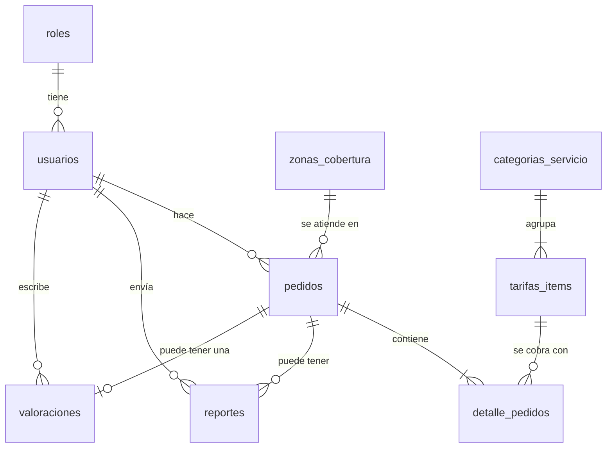

# Base de datos

Laravel utiliza el driver `mysql`. El esquema fuente está en `Api-Rest/database/migrations`; las semillas se encuentran en `database/seeders`. No distribuir bases locales, dumps con registros reales ni el archivo sin extensión `Api-Rest/swiftsite_clean`, identificado como SQLite local.

| Tabla | Clave primaria | Relaciones y datos |
| --- | --- | --- |
| `roles` | `id_rol` | `nombre_rol` único; tiene usuarios |
| `usuarios` | `id_usuario` | `id_rol` → roles; nombre, teléfono, correo único **opcional** (un cliente agregado desde el panel puede no tenerlo; migración `permitir_cliente_sin_correo`) y password_hash |
| `categorias_servicio` | `id_categoria` | nombre único, descripción, activo y presentación en la app (`icono`, `pregunta_tipo`, `pregunta_variante`, `pregunta_cantidad`, `unidad`, `nota`, `cantidad_max`; todos opcionales) |
| `tarifas_items` | `id_tarifa` | `id_categoria` → categorías; tipo, material, precio_unitario, activo y textos opcionales (`detalle`, `descripcion`) |
| `zonas_cobertura` | `id_zona` | nombre único, recargo y activo |
| `pedidos` | `id_pedido` | `id_usuario` nullable → usuarios; `id_zona` → zonas; dirección, fechas, estado e importes |
| `detalle_pedidos` | `id_detalle` | `id_pedido` → pedidos; `id_tarifa` → tarifas; cantidad e importes |
| `reportes` | `id_reporte` | `id_pedido` → pedidos; `id_usuario` → usuarios; motivo, descripción (hasta 500), estado (`Recibido`, `En revisión`, `Resuelto`) y respuesta del equipo opcional; `fecha_creacion` y `fecha_actualizacion` |
| `valoraciones` | `id_valoracion` | `id_pedido` único → pedidos (una valoración por pedido); `id_usuario` → usuarios; estrellas (1 a 5), aspectos opcionales (JSON), comentario opcional (hasta 500), estado (`Pendiente`, `Publicada`, `Oculta`; nace `Pendiente` y solo el administrador la publica); `fecha_creacion` y `fecha_actualizacion` |

Las claves foráneas restringen eliminación de registros relacionados y actualizan las referencias en cascada. Los campos monetarios son DECIMAL(10,2); las restricciones exigen importes no negativos y cantidad positiva en el detalle. Las tablas de negocio no tienen timestamps convencionales de Eloquent; pedidos usa `fecha_creacion`.

También se conservan las migraciones iniciales de infraestructura: users, password_reset_tokens, sessions, cache/cache_locks, jobs/job_batches/failed_jobs y personal_access_tokens de Sanctum. La autenticación de negocio utiliza usuarios, no users. No eliminar migraciones ya aplicadas para simplificar la apariencia del esquema.

## Inicializar una base nueva

1. Instalar y arrancar un servidor MySQL compatible con CHECK constraints. La comprobación local se realizó con MariaDB 10.4.32 y driver mysql.
2. Crear una base vacía y un usuario propio con permisos sobre esa base. No usar una base productiva ni compartir la contraseña en Git.
3. Copiar `.env.example` a `.env` solo si este no existe, y completar DB_DATABASE, DB_USERNAME y DB_PASSWORD.
4. Desde Api-Rest, ejecutar:

```bash
composer install
php artisan key:generate
php artisan migrate
php artisan db:seed
```

`DatabaseSeeder` ejecuta RolesSeeder, CategoriasServicioSeeder, ZonasCoberturaSeeder y TarifasItemsSeeder. Crea Cliente/Administrador y catálogos de ejemplo; no crea una cuenta administrativa ni una contraseña común.

`CategoriasServicioSeeder` solo crea las categorías que faltan (no pisa lo que el administrador editó u ocultó). `ZonasCoberturaSeeder` y `TarifasItemsSeeder` usan updateOrInsert: reejecutarlos puede restablecer precios, recargos o indicadores activo; revisar antes de hacerlo sobre datos ya personalizados. Los textos de presentación de los servicios iniciales viven en `database/seeders/PresentacionCatalogo.php`, que solo rellena campos vacíos. No se ejecutaron durante la preparación de GitHub.

## Cambios de esquema y pruebas

Agregar una migración nueva para cambios acordados. Revisar índices, claves, precisión decimal y reversibilidad; no editar o borrar migraciones aplicadas por otros integrantes sin coordinar. Nunca utilizar migrate:fresh o DROP como procedimiento habitual de actualización.

La suite PHPUnit existente utiliza SQLite en memoria para fixtures de pruebas. Las migraciones monetarias incluyen ALTER TABLE ADD CONSTRAINT de MySQL, por lo que algunos tests definen un esquema de prueba específico. Esto no cambia la conexión de la aplicación.

`php scripts/verify-sprint2.php` verifica el esquema y la autenticación con el MySQL local, creando fixtures en una transacción y revirtiéndola. No modifica usuarios existentes ni deja tokens de prueba; sí puede consumir números de autoincremento. Ejecutar solo en un entorno local preparado.

## Cómo se maneja la base de datos (resumen para explicarlo)

**Idea central:** la base de datos no se arma a mano en MySQL; se *describe con código* y Laravel la construye.

| Pieza | Qué es | Analogía | Comando |
| --- | --- | --- | --- |
| Migración (`database/migrations`) | Un archivo que dice "crea esta tabla / agrega esta columna". Laravel recuerda cuáles ya aplicó. | Los planos de una casa, con una hoja por cada remodelación. | `php artisan migrate` |
| Seeder (`database/seeders`) | Datos iniciales: roles, categorías, zonas, tarifas. | Los muebles con que se entrega la casa. | `php artisan db:seed` |
| Modelo (`app/Models`) | La clase PHP que representa una tabla (`Pedido`, `Usuario`…). | El control remoto de cada tabla. | — |
| MySQL (XAMPP) | Donde viven físicamente las tablas y los datos. | El terreno. | Iniciar MySQL en XAMPP |

**Qué pasa cuando alguien dice "actualicé la base con comandos":** con XAMPP y MySQL encendidos, `php artisan migrate` lee las migraciones que todavía no se han aplicado y ejecuta solo esas contra MySQL. No borra datos. Por eso cualquier compañero puede clonar el repositorio, correr `php artisan migrate --seed` y tener **la misma estructura**, sin pasarse archivos `.sql`.

**Por qué es buena práctica:** el esquema queda versionado en Git junto al código, es reproducible en cualquier computadora y cada cambio es reversible (`down()` de cada migración).

### Flujo de datos de un pedido



`detalle_pedidos` guarda una copia del precio al momento de pedir: si el administrador cambia una tarifa después, los pedidos viejos no cambian.

## Servicios nuevos sin tocar código

La app del cliente no trae servicios escritos en el código: los lee de la API (`GET /api/categorias`, `/api/tarifas`, `/api/zonas`). Para ofrecer un servicio nuevo (por ejemplo "Limpieza de pisos") solo se usa el panel administrativo:

1. **Catálogos › Categorías › Nueva categoría.** Nombre, descripción (se ve en el Inicio de la app), ícono y, si se quiere, los textos de la calculadora (preguntas, unidad, aviso y cantidad máxima).
2. **Catálogos › Tarifas y precios › Nueva tarifa.** Al menos una tarifa normal en esa categoría; el artículo es la primera elección del cliente y el material/tamaño la segunda (la que cambia el precio). Opcionalmente un detalle corto ("por m²") y qué incluye.
3. Los extras se crean como tarifas cuyo nombre empieza con `Extra:` y se cobran por cada unidad.

Un servicio aparece en la app solo si está **visible** y tiene **al menos una tarifa visible que no sea un extra**. El panel lo avisa en la tabla de categorías.

Qué sigue siendo del código (a propósito): el catálogo de íconos (13 dibujos que la app sabe pintar; no se puede dibujar uno nuevo desde el panel) y las fotos de antes/después del Inicio. Subir imágenes requeriría almacenamiento de archivos y quedó fuera del MVP.
